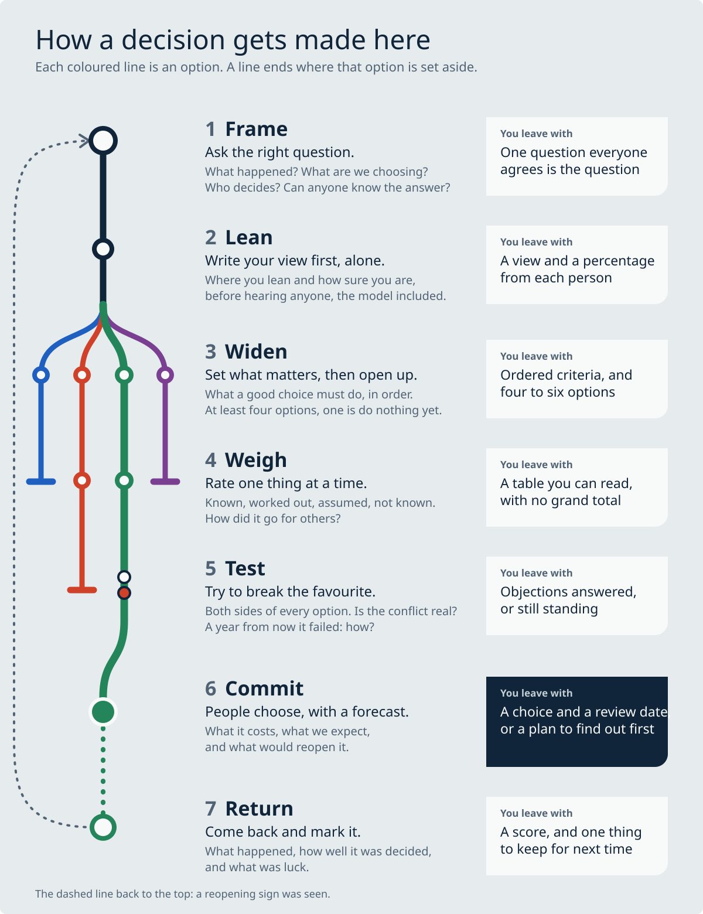

# Agent Judgement

A guide for decisions that matter. It works through a choice with you, keeps one plain record, and
draws a board you can open in any browser. The people decide. The agent asks good questions, finds
evidence, argues every side and writes it down.

Made for Claude Code and Codex. There is nothing to run.



## Use it

Say what you are trying to decide:

> Help us decide whether to rebuild the site or repair the one we have.

Easy to undo? It takes about ten minutes. Hard to undo? It takes you through all seven stages, and
you can stop and pick up later.

| Skill | What it does |
| ----- | ------------ |
| **judgement-decide** | Takes you from the question to a commitment |
| **judgement-look-back** | Marks the forecasts, checks the reopening signs, keeps one lesson |
| **judgement-board** | Draws the board from the record |

## What you get

```text
docs/agent-judgement/
  2026-09-02-heating-system/     the date it started, then its title
    decision.json                the record: one file, one published format
    board.html                   the picture: opens with a double click, works offline
```

Look at two: a library choosing its heating ([record](examples/heating-system/decision.json),
[board](examples/heating-system/board.html)), and a factory that depends on one foundry, marked a year
later ([record](examples/one-foundry/decision.json), [board](examples/one-foundry/board.html)).
Download a board and open it.

The record follows [a JSON Schema](schema/decision.schema.json), so any tool can read it. It keeps
each person's first view, the options that were set aside and why, what is known and what is
assumed, the objections that still stand, what you expect to happen, and what did.

## What people ask a decision tool for

| You want | How this does it |
| -------- | ---------------- |
| To solve the right problem | Frame comes first and starts from what actually happened |
| To see the whole system | A short map of who and what it touches, and what helps or hurts what |
| A better answer than a compromise | Show that two aims truly clash, then try to separate them by time, place, condition, scale or role |
| Honest uncertainty | Four bins: known, worked out, assumed, not known. "Not enough yet" is a finished result with a plan |
| Conclusions that have been tested | Both sides of every option, and every objection with a state and the cheapest test |
| A record of why | One file with the reasons, the dissent, the forecasts and the outcome |
| A plan people can act on | Steps with owners and gates, and measures with a target |
| Clear authority | People commit. If nobody present can, the record says who could |
| Speed | Depth follows how hard the choice is to undo |

There are [starting points](skills/judgement-decide/references/starters.md) for joining two
organisations, choosing technology to back, finding a message, unsticking a programme, picking new
ventures, rolling out across places, and choosing a design.

## Why it works this way

Every step traces to a study, a standard or a stated expert view:
[why each step is there](skills/judgement-decide/references/evidence.md). Where schools of thought
disagree, the guide says when to use each:
[perspectives](skills/judgement-decide/references/perspectives.md).

## Install

Clone this repository, then:

- **Claude Code:** start it with `claude --plugin-dir path/to/agent-judgement`.
- **Codex:** add the clone as a local plugin. Its manifest is in `.codex-plugin`.

## Check it

```sh
node --test tests/*.test.mjs
```

The checks need Node 20 or later. The plugin itself needs nothing.

## Credits and licence

MIT. See [NOTICE](NOTICE) for the open projects whose ideas it learned from.
